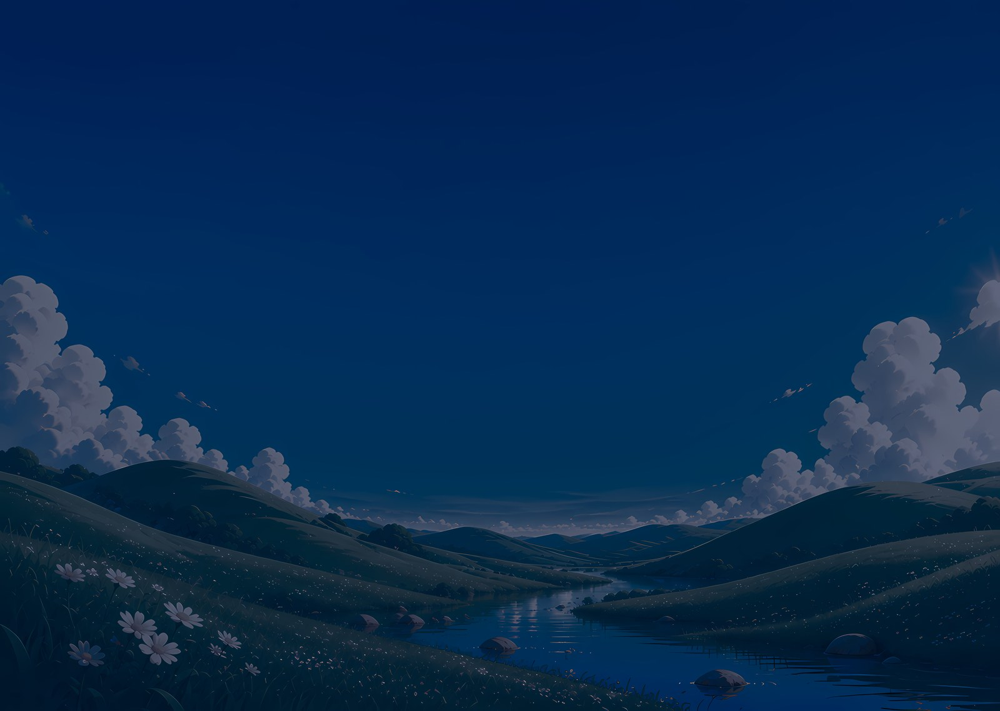

# Dusk Valley

A theme for T3 Code: moonlit hills behind frosted glass.

- A dithered night-hills background across the chat, the new-thread page, and the PR, Issues, Settings and Usage pages
- Frosted glass on the composer, your messages, the thread details card, popups, menus and dialogs
- A frosted sidebar, right panel and terminal drawer, with film grain
- A compact two-line sidebar card: the title on top, then project/server/PR icons and the status on the right
- The Nightly pill and T3 logo hidden

## Install

Requires **T3 Code Nightly 0.1.11 or later**. Older builds can't load the background image.

1. Download this repo (**Code → Download ZIP**) and unzip it.
2. Copy **both** `dusk-valley.json` and `dusk-valley.png` into your themes folder, side by side:
   - macOS / Linux: `~/.t3/userdata/themes/`
3. Restart T3 Code, then choose **Dusk Valley** in **Settings → Appearance**.

> Importing only the `.json` through Settings → Appearance works, but you'll get the glass without the background. The image has to sit next to the theme file in the themes folder.

## Notes

- The dither is baked at 3024px wide, a 14" MacBook Pro's native resolution. On other screens it still looks good, but the dots soften slightly when scaled.
- Themes only apply on desktop and web, not mobile.
- Background art: the hills illustration, upscaled with Real-ESRGAN and ordered-dithered.
